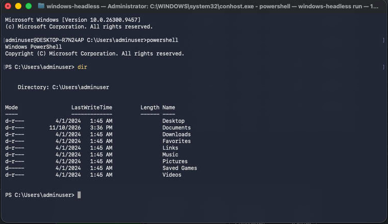
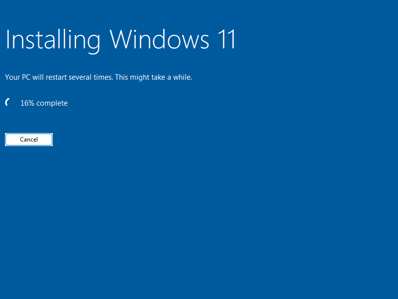
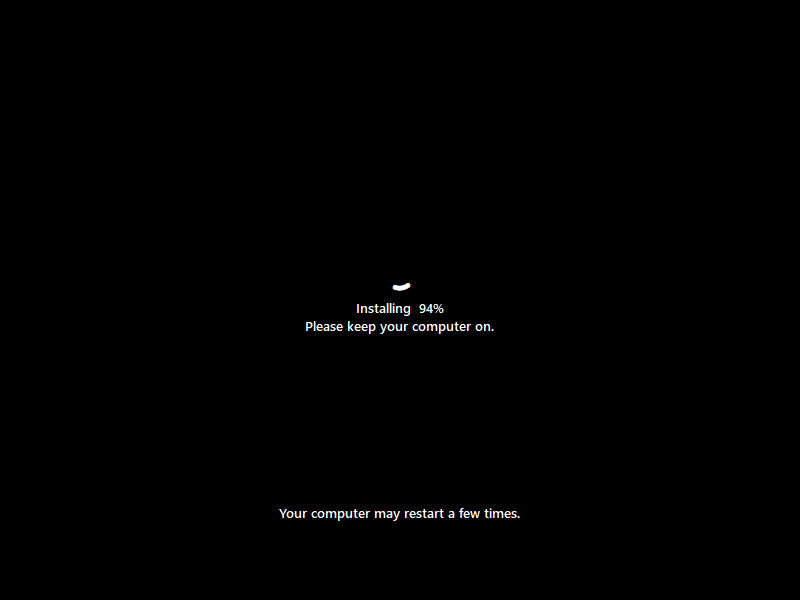
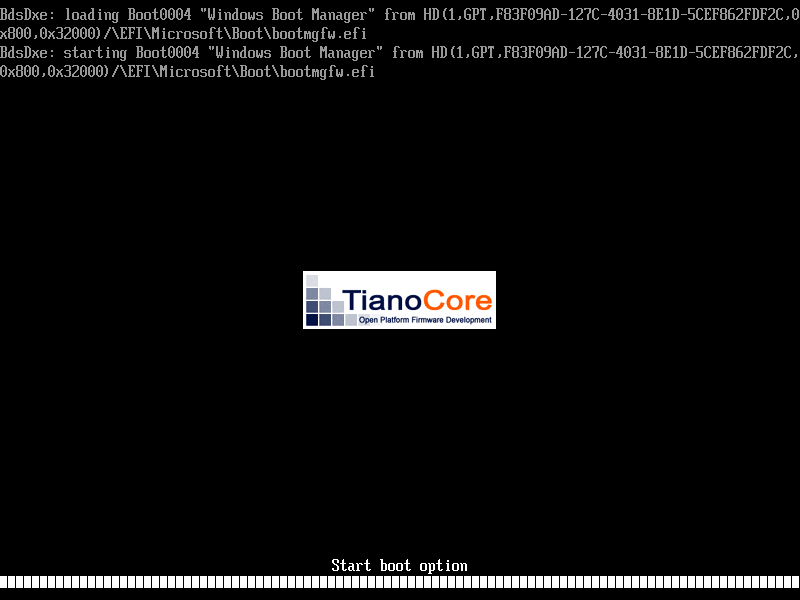
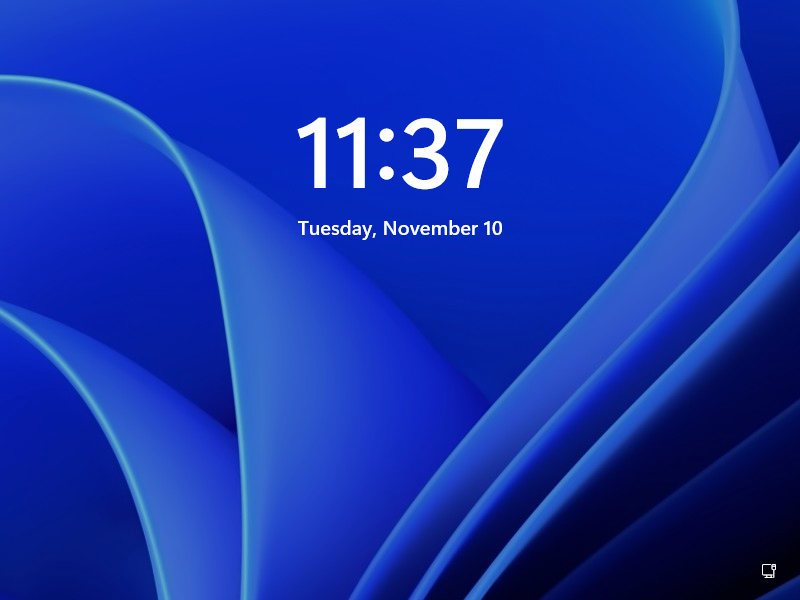

> [windows-headless](https://github.com/jzombie/windows-headless) is in alpha: one command turns a Microsoft retail ISO into an SSH-ready Windows 11 VM, headless, with no daemon, no GUI, no host packages, and no Docker. Also published on [crates.io](https://crates.io/crates/windows-headless). Source: [jzombie/windows-headless](https://github.com/jzombie/windows-headless).

Right now this is a tool for [Rust](https://rust-lang.org/) users on macOS or Linux: developers who need to compile for Windows locally or debug Windows behavior without leaving their machine. If that is you, the pitch is simple. Input: a retail ISO (amd64 or arm64, matching your host). Output: an SSH shell running Windows 11. The installer runs unattended inside an in-process QEMU guest, and the CLI blocks until the shell is reachable.

Distribution is source-only for now. There are no prebuilt binaries to download; you build it yourself with Cargo (details below).



## The one command

```sh
# Build the installer, boot the VM, land at a Command Prompt in the same terminal.
# Always use release. Debug builds slow every status tick.
cargo run --release -- run --win-iso <PATH_TO_WIN_ISO>
```

Or split the phases:

```sh
cargo run --release -- build --win-iso <PATH_TO_WIN_ISO>
cargo run --release -- run
```

Sizing follows Docker style: `--memory 8g --cpus 8 --disk-size 128g` (defaults: `4g`, `4`, `64g`). When ready, the CLI prints the connect line, typically `ssh -p 2232 AdminUser@127.0.0.1`. VNC is available at `vnc://127.0.0.1:5910` for watching. Requires a Rust toolchain (`cargo` 1.85+); nothing prebuilt is published yet, so the commands below build from source first. Everything else downloads automatically on first run and executes from the cache.

## What you get

A real VM, provisioned in process:

- **Unattended install.** The tool builds installer media from your ISO (answer file selects the Windows 11 Pro image, `en-US`) and boots it. Typical time to SSH on macOS: 10 to 15 minutes from first boot, with outliers to 18.
- **Portable hypervisor.** QEMU, wimlib, and the virtio-win driver pack come from [lab-qemu-portable](https://github.com/jzombie/lab-qemu-portable) as zero-install archives, SHA-256 verified against pins in `src/pins.rs`. The host stays clean.
- **One driver, automatic.** The specialize pass installs the Red Hat VirtIO NetKVM driver so the guest gets network, hence SSH. Storage stays on inbox NVMe (`stornvme`), graphics on `ramfb`. No driver hunting.
- **Library surface.** Thin CLI over exported `VmConfig`, `HeadlessVmBuilder`, and `DiskManager` if you want to drive it programmatically.

## Watching a headless install

Headless does not mean blind. During the install phase only, screenshots land in `<cache>/vms/win11/screenshots/` every 60 seconds, and an in-memory classifier labels frames between saves (installer progress, OOBE, firmware boot art, lock/idle, plus error states like modal dialogs, UEFI shell, and recovery). Capture stops once the install completes.







Two caveats, stated plainly in the [README](https://github.com/jzombie/windows-headless#commands): the kNN classifier can misread, and alerts only fire on error state plus an idle guest (no disk I/O, no growth). Pixel-change motion sensing tracks aliveness independently, and dead boots terminate with a diagnosis block naming the latest frame, screen state, last serial line, and firmware reboot count.

## Snapshots: golden rewind by default

The first proven boot saves a golden snapshot automatically. Every later `run` rewinds to it first, so a dirty stop (Ctrl-C) cannot leave the next boot in Recovery.

```sh
# Terminal 1: boot and leave it running (run blocks).
cargo run --release -- run
```

```sh
# Terminal 2: re-take golden from the running guest. Next run resumes the new state.
cargo run --release -- snapshot
```

### Live resume, experimental

Live snapshots also save RAM. Apple Silicon with cache on external USB tends to favor rewind (about 19s spawn-to-SSH versus about 23s live in the README's comparison). Older Intel i7 machines with internal SSDs tend to favor live. Both types coexist as separate sidecars, and `run` selects by flag. Benchmark both on your hardware and default to rewind unless live measures faster.

## Alpha status and tested surface

Status is alpha, with a clear split: rock solid and performant on macOS Apple Silicon (M1+), working on Linux amd64 and arm64, with older circa-2015 Intel Linux hosts occasionally struggling at the initial SSH handoff. Intel Macs are unsupported. Windows hosts are untested (the portable tree ships a Windows QEMU build, but the install path there is unexercised).

Proven installs are logged to `tested-isos.jsonl` with a Tested table in the README covering macOS HVF, Linux KVM, and TCG fallback runs. Untested by design: non-English media, non-retail ISOs (Enterprise, OEM), mixed arch guests (x64 Windows on ARM hosts), and cross-arch TCG in general.

The standing advice for bug reports: use all defaults for the first install. A green default install separates pipeline faults from configuration faults. Then tune, then file issues with logs.

----

*Repo: [jzombie/windows-headless](https://github.com/jzombie/windows-headless). Installs from source via `cargo run --release`. Issues and run reports: [github.com/jzombie/windows-headless/issues](https://github.com/jzombie/windows-headless/issues). Dependency layer: [lab-qemu-portable](https://github.com/jzombie/lab-qemu-portable).*
